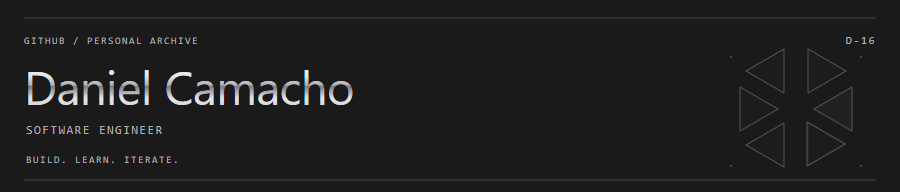
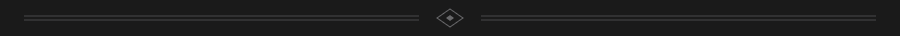
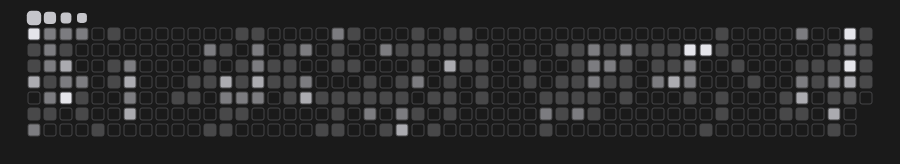
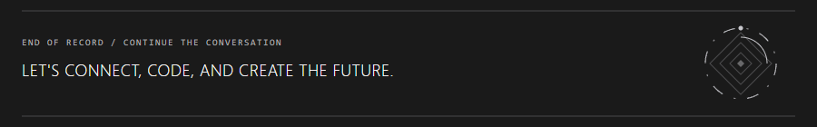

<picture>
  <source media="(prefers-color-scheme: light)" srcset="assets/nier-header-v5-light.gif">
  
</picture>

<picture>
  <source media="(max-width: 600px) and (prefers-color-scheme: light)" srcset="assets/nier-intro-mobile-v5-light.svg">
  <source media="(max-width: 600px)" srcset="assets/nier-intro-mobile-v5-dark.svg">
  <source media="(prefers-color-scheme: light)" srcset="assets/nier-intro-v5-light.svg">
  
</picture>

<a href="https://dcamacho-dev.vercel.app/" title="Explore my portfolio"><picture><source media="(prefers-color-scheme: light)" srcset="assets/nier-link-portfolio-v2-light.svg"></picture></a>

<picture>
  <source media="(prefers-color-scheme: light)" srcset="assets/nier-divider-v3-light.gif">
  
</picture>

<picture>
  <source media="(prefers-color-scheme: light)" srcset="assets/nier-section-loadout-v3-light.svg">
  
</picture>

<picture>
  <source media="(prefers-color-scheme: light)" srcset="assets/nier-stack-v4-light.svg">
  
</picture>

<picture>
  <source media="(prefers-color-scheme: light)" srcset="assets/nier-divider-v3-light.gif">
  
</picture>

<picture>
  <source media="(prefers-color-scheme: light)" srcset="assets/nier-section-telemetry-v3-light.svg">
  
</picture>

<picture>
  <source media="(prefers-color-scheme: light)" srcset="assets/github-telemetry-light.svg">
  
</picture>

  
  

<picture>
  <source media="(prefers-color-scheme: light)" srcset="assets/nier-divider-v3-light.gif">
  
</picture>

<picture>
  <source media="(prefers-color-scheme: light)" srcset="assets/nier-section-contributions-v3-light.svg">
  
</picture>

<picture>
  <source media="(prefers-color-scheme: light)" srcset="assets/nier-contributions-v3-light.gif">
  
</picture>

<picture>
  <source media="(prefers-color-scheme: light)" srcset="assets/nier-footer-v4-light.gif">
  
</picture>

<a href="https://www.facebook.com/hardy.0777" title="Connect with me on Facebook"><picture><source media="(prefers-color-scheme: light)" srcset="assets/nier-link-facebook-light.svg"></picture></a> <a href="https://www.instagram.com/dear.dnl/" title="Find me on Instagram"><picture><source media="(prefers-color-scheme: light)" srcset="assets/nier-link-instagram-light.svg"></picture></a> <a href="https://www.linkedin.com/in/danielcamacho777/" title="Connect with me on LinkedIn"><picture><source media="(prefers-color-scheme: light)" srcset="assets/nier-link-linkedin-light.svg"></picture></a> <a href="mailto:danielcamacho0416@gmail.com" title="Send me an email"><picture><source media="(prefers-color-scheme: light)" srcset="assets/nier-link-email-light.svg"></picture></a>

